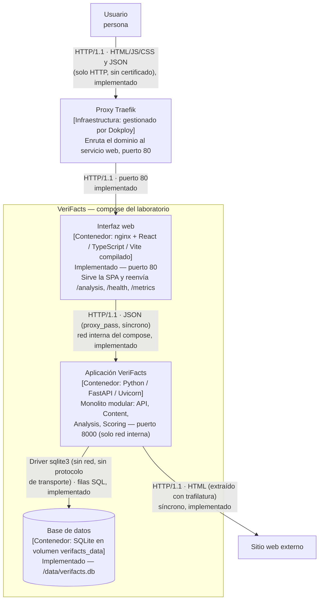
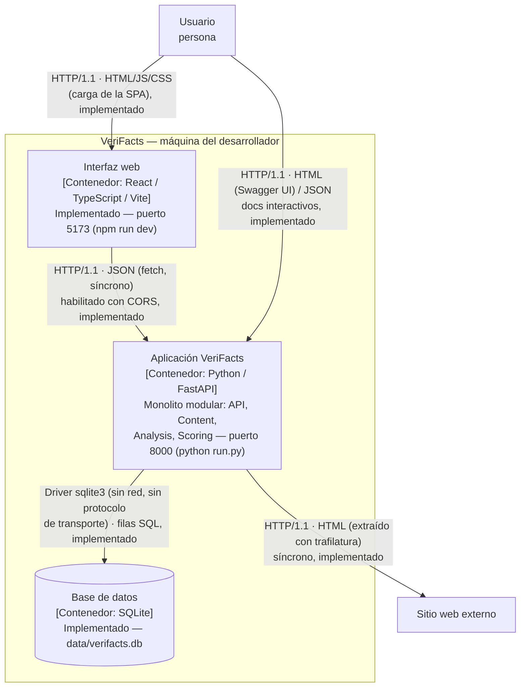

# C4 — Nivel 2: Contenedores de VeriFacts

## Descripción

El diagrama de contenedores muestra las unidades desplegables/ejecutables
que componen VeriFacts y cómo se comunican. Se presentan **dos vistas** del
mismo sistema:

1. **Despliegue de referencia (servidor del laboratorio, Dokploy)**: es el
   que se documenta en [arc42 §7.1.1](../arc42/07-despliegue.md). Un único
   dominio; `nginx` sirve la interfaz web y reenvía `/analysis`, `/health` y
   `/metrics` a la API por la red interna del compose.
2. **Modo de desarrollo local**: dos procesos separados (`npm run dev` en el
   puerto 5173 y `python run.py` en el 8000), con CORS habilitado.

En ambas vistas existen **tres** contenedores propios: la interfaz web
(React + Vite), la aplicación FastAPI (monolito modular) y la base de datos
SQLite.

## Leyenda

| Notación | Significado |
|---|---|
| Rectángulo con "[Contenedor: ...]" | Unidad desplegable/ejecutable |
| Rectángulo con "[Infraestructura: ...]" | Pieza gestionada por la plataforma, fuera del código de VeriFacts |
| Flecha continua (`-->`) | Comunicación o dependencia **implementada** |
| Flecha punteada (`-.->`) | Comunicación o dependencia **prevista, no implementada** |
| Texto "(previsto, no implementado)" dentro de un nodo | El contenedor existe en el diseño pero aún no tiene código ejecutable |
| Etiqueta sobre la flecha | `Protocolo · Formato`, seguido del estado (`implementado`/`previsto`) — ver [ADR-0003](../adr/0003-integracion-sincrona.md) para el porqué de que todas sean síncronas |

## Vista 1 — Despliegue de referencia (laboratorio, Dokploy)

Solo `web` se expone al exterior; `api` no tiene dominio propio. El
frontend se compila con `VITE_API_BASE_URL` vacía y llama a rutas relativas,
por lo que no necesita CORS en este despliegue.

## Vista 2 — Modo de desarrollo local

## Contenedores

| Contenedor | Tecnología | Estado | Descripción |
|---|---|---|---|
| Interfaz web | React 18 + TypeScript + Vite; en el despliegue del laboratorio se compila y se sirve con nginx ([`frontend/Dockerfile`](../../frontend/Dockerfile), [`frontend/nginx.conf`](../../frontend/nginx.conf)) | **Implementado** | Formulario de análisis, panel de resultado y consulta del historial paginado. No contiene lógica de negocio: solo llama a la API (`frontend/src/api/client.ts`). En el laboratorio, nginx además reenvía `/analysis`, `/health` y `/metrics` a la API |
| Aplicación VeriFacts | Python 3.11 + FastAPI + Uvicorn | **Implementado** | Expone la API HTTP; internamente organizada en los módulos `API`, `Content`, `Analysis`, `Scoring` (ver [Sección 5 — Vista de bloques](../arc42/05-vista-de-bloques.md)); habilita CORS para el origen de la interfaz web en desarrollo (`app/main.py`) |
| Base de datos | SQLite | **Implementado** | Persistencia del historial de análisis (`app/persistence/repository.py`): id, contenido normalizado, score, clasificación, factores, origen (`source_type`), fecha de creación. En el laboratorio vive en el volumen `verifacts_data` |
| Proxy Traefik | Traefik (gestionado por Dokploy) | Infraestructura de la plataforma | No forma parte del código de VeriFacts; enruta el dominio al servicio `web`. Se configura en el panel (pestaña Domains) |

## Nota sobre el estado actual

Hoy existen tres puntos de entrada verificables sobre la API HTTP: el
esqueleto de disponibilidad (`GET /health`), el corte vertical completo de
análisis (`POST /analysis`, con origen `text` o `url` y persistencia real
en SQLite), y el historial paginado (`GET /analysis`, `GET /analysis/{id}`),
tal como se documenta en el
[corte vertical ejecutable del README](../../README.md#corte-vertical-ejecutable)
y en la [Sección 6 — Vista de ejecución](../arc42/06-vista-de-ejecucion.md).
La interfaz web consume los tres desde el navegador.

**Corrección S7:** la flecha `API → Sitio web externo` aparecía antes
punteada, marcada "previsto, no implementado". Eso dejó de ser cierto
desde que `app/modules/content/service.py` incorporó
`extract_from_url()` (vía `trafilatura`), y hoy está reflejada como
implementada. Todas las flechas de los diagramas son hoy implementadas y
síncronas; el contrato formal de cada una vive en
[docs/contracts/openapi.yaml](../contracts/openapi.yaml) y la decisión de
mantenerlas síncronas está en [ADR-0003](../adr/0003-integracion-sincrona.md).

**Corrección S12:** el diagrama anterior mostraba al navegador hablando
directamente con Vite (5173) y con la API (8000), lo que describe solo el
modo de desarrollo. El despliegue de referencia del laboratorio pasa por
Traefik y nginx; ahora ambas vistas están separadas. Ver el detalle del
despliegue en [arc42 §7](../arc42/07-despliegue.md) y la decisión en
[ADR-0010](../adr/0010-despliegue-laboratorio-dokploy.md).

**Fuera de este diagrama:** el prototipo aislado de mensajería
(`experiments/messaging/`) no es un contenedor de VeriFacts: no se
despliega ni lo importa ningún módulo de `app/`. Ver
[ADR-0013](../adr/0013-no-incorporar-mensajeria-asincrona.md).

Ver también el diagrama de Nivel 1: [C4 — Contexto](01-contexto.md) y el de
Nivel 3: [C4 — Componentes](03-componentes.md).
