# Entrega Semana 14: Evaluación de Arquitectura — Medición de Escenarios de Calidad y Resultados de la Revisión de Pares

**Asignatura:** Arquitectura de Software  
**Proyecto:** VeriFacts — Plataforma de Detección de Indicadores de Desinformación  
**Organización:** ISCOUTB  
**Equipo de Trabajo:**
- Pedro Jose Castro Blanquicett
- Cristian David Cardeno Gulloso
- Julian Samuel Cabeza Pena  
**Repositorio:** [https://github.com/ISCOUTB/AS_202620_Verifacts](https://github.com/ISCOUTB/AS_202620_Verifacts)  
**Despliegue Oficial en Producción:** [https://verifacts.iscoutb.dev](https://verifacts.iscoutb.dev)  
**Fecha:** 2026-11-05  
**Estado:** Incremento local de Semana 14 (preparado para revisión y aprobación del equipo)  
**Trazabilidad Arquitectónica:** arc42 [§10 (Escenarios de Calidad)](../arc42/10-escenarios-de-calidad.md), [§11 (Riesgos y Deuda Técnica)](../arc42/11-riesgos-y-deuda-tecnica.md#114-riesgos-y-observaciones-señaladas-en-la-revisión-de-pares-semana-14), [ADR-0008](../adr/0008-mantener-render-mitigar-arranque-frio.md), [ADR-0010](../adr/0010-despliegue-laboratorio-dokploy.md), [ADR-0012](../adr/0012-modelo-almacenamiento-sqlite-costo-reversion.md) y [ADR-0013](../adr/0013-no-incorporar-mensajeria-asincrona.md).

---

## Resumen Ejecutivo

La presente entrega formaliza la **Evaluación de la Arquitectura de Software** de VeriFacts conforme a los lineamientos metodológicos del curso (método **ATAM** — *Architecture Tradeoff Analysis Method*, identificación de cuellos de botella y estrategias de optimización), abordando dos frentes obligatorios:

1. **Resultado de la medición cuantitativa contrastado con el umbral numérico del escenario:**
   Evaluación empírica y contrastación rigurosa del escenario de rendimiento **Q-01** ($P95 \le 3.000\text{ ms}$ ante cargas de 10.000 caracteres) y de consistencia **Q-05** ($100\%$ de repetibilidad). Se presenta la comparación multidimensional de resultados en tres entornos operativos: **Local (S9)**, **Render Cloud (S10)** y el despliegue en **Producción en el Servidor del Laboratorio UTB con Dokploy (`https://verifacts.iscoutb.dev`)**, analizando cuellos de botella reales (perfilamiento de red TLS vs. cómputo sintáctico vs. persistencia SQLite) y sustentando las decisiones de optimización (caching, desacoplamiento y persistencia de procesos).
2. **Incorporación a arc42 Sección 11 de los hallazgos señalados en la revisión de pares:**
   Integración formal de las observaciones recibidas durante la sesión de coevaluación y revisión entre pares en la subsección [§11.4 de arc42](../arc42/11-riesgos-y-deuda-tecnica.md#114-riesgos-y-observaciones-señaladas-en-la-revisión-de-pares-semana-14). Los hallazgos de los pares se categorizan con honestidad técnica según su probabilidad, impacto, estado real en el código (*Pendiente*, *Parcial* o *Mitigado*) y se trazan hacia los modos de fallo del sistema (**MF-01**, **MF-03**, **MF-07**, **MF-08** y **MF-09**).

---

## 1. Resultado de la Medición Contrastado con el Umbral del Escenario

### 1.1 Caracterización Formal de los Escenarios de Calidad Evaluados

Siguiendo la especificación canónica de escenarios de calidad de 6 partes establecida en [`docs/escenarios-de-calidad.md`](../escenarios-de-calidad.md):

```mermaid
flowchart LR
    F["Fuente: Usuario final / Cliente HTTP"] -->|Estímulo: POST /analysis con 10.000 caracteres| S["Sistema VeriFacts (Pipeline + SQLite)"]
    S -->|Respuesta: Análisis completado e id retornado| R["Artefacto: API / Pipeline"]
    R -->|Medida: P95 <= 3.000 ms| U{"Umbral Q-01"}
    U -->|P95 real = 46,9 ms (Local) / 195,4 ms (Dokploy)| V["Veredicto: CUMPLE"]
```

#### Ficha del Escenario Principal: Q-01 (Rendimiento)
* **Atributo de Calidad:** Rendimiento (*Performance / Latency*).
* **Fuente del Estímulo:** Usuario final mediante navegador web o cliente API automatizado.
* **Estímulo:** Envío de un texto extenso de hasta **10.000 caracteres** para análisis sintáctico de desinformación (`POST /analysis`).
* **Artefacto Afectado:** Pipeline completo de análisis (`app/api/routes.py`, `app/rules/engine.py`, `app/persistence/repository.py`).
* **Entorno:** Operación normal en servidor de producción con concurrencia nominal (un cliente secuencial de medición).
* **Respuesta Esperada:** El sistema extrae métricas, evalúa las reglas heurísticas, almacena el resultado en base de datos y retorna el JSON con `score`, clasificación y factores detectados.
* **Medida Numérica / Umbral Exigido:** **$P95 \le 3.000\text{ ms}$ (3,0 segundos)**.

#### Ficha del Escenario Secundario: Q-05 (Consistencia / Repetibilidad)
* **Atributo de Calidad:** Disponibilidad / Consistencia.
* **Medida Numérica / Umbral Exigido:** **$100\%$ de coincidencia** en la clasificación y factores detectados ante el mismo texto de entrada en $N$ repeticiones sucesivas.

---

### 1.2 Protocolo Experimental y Manifiesto de Medición

Para garantizar reproducibilidad científica, las mediciones se ejecutaron empleando scripts automatizados versionados en el repositorio ([`scripts/medir_q01_q05.py`](../../scripts/medir_q01_q05.py) y [`scripts/medir_render.py`](../../scripts/medir_render.py)), bajo las siguientes condiciones controladas:

| Parámetro Experimental | Especificación del Protocolo |
|---|---|
| **Carga de Prueba (Payload)** | Texto sintético representativo de 10.000 caracteres generado por [`scripts/payload_10k.py`](../../scripts/payload_10k.py), combinando afirmaciones absolutas, mayúsculas sostenidas y signos de exclamación reiterados. |
| **Operación Evaluada** | `POST /analysis` enviando `{"text": "<payload_10k>"}` con cabecera `Content-Type: application/json`. |
| **Cliente de Medición** | Cliente HTTP basado en `httpx.Client` ejecutado en modo secuencial, registrando tiempos de ida y vuelta mediante `time.perf_counter()`. |
| **Tamaño Muestral ($n$)** | $n = 200$ corridas locales; $n = 50$ corridas en caliente en entornos remotos; $n = 3$ corridas en frío tras 20 min de inactividad estricta. |
| **Fórmula de Percentil 95 ($P95$)** | Para una serie ordenada $V$ de longitud $N$: $P95 = V[\lceil 0.95 \times N \rceil - 1]$. |

---

### 1.3 Resultados Empíricos Comparativos por Entorno Operativo

Se consolidan las mediciones históricas y actuales de VeriFacts a través de sus tres hitos de infraestructura:

```
Comparativa P95 frente al Umbral de 3.000 ms:
Umbral Máximo Q-01 : |============================================================| 3.000 ms
Local (S9)         : |=| 46,9 ms (Margen 64x)
Dokploy UTB (S14)  : |===| 195,4 ms (Margen 15x)
Render Caliente(S10): |====| 211,3 ms (Margen 14x)
Render Frío (S10)  : |================================================================================...| 22.450 ms (FALLA)
```

#### Tabla 1: Matriz de Contraste Numérico de Rendimiento (Q-01 y Q-05)

| Entorno Operativo | Muestra ($n$) | Mediana (ms) | P95 Medido (ms) | Máximo (ms) | Umbral Exigido | Margen de Seguridad | Veredicto Q-01 | Veredicto Q-05 |
|---|---:|---:|---:|---:|---:|---:|:---:|:---:|
| **1. Local (S9)**<br>*(uvicorn 127.0.0.1, SQLite temporal)* | 200 | 16,6 | **46,9** | 82,3 | $\le 3.000\text{ ms}$ | $63,9\times$ | **CUMPLE** | **CUMPLE** (100%) |
| **2. Render Cloud (S10) — Caliente**<br>*(Servicio activo, red WAN pública)* | 50 | 197,1 | **211,3** | 505,2 | $\le 3.000\text{ ms}$ | $14,2\times$ | **CUMPLE** | **CUMPLE** (100%) |
| **3. Render Cloud (S10) — Frío**<br>*(Tras 20 min inactividad, sleep free-tier)* | 3 | 22.348,0 | **22.450,0** | 22.515,6 | $\le 3.000\text{ ms}$ | **-7,5x (Excedido)** | **NO CUMPLE** | **CUMPLE** (100%) |
| **4. Dokploy Lab UTB (S14 — Oficial)**<br>*(https://verifacts.iscoutb.dev)* | 50 | 178,2 | **195,4** | 310,5 | $\le 3.000\text{ ms}$ | $15,3\times$ | **CUMPLE** | **CUMPLE** (100%) |

---

### 1.4 Análisis de Cuellos de Botella Arquitectónicos (Diapositiva 8)

Conforme a las técnicas de identificación de cuellos de botella expuestas en clase (*profiling*, descomposición de trazas y latencia diferencial):

```mermaid
gantt
    title Descomposición de la Latencia en Producción (POST /analysis - 195 ms totales)
    dateFormat X
    axisFormat %s ms
    Transporte WAN + Cloudflare TLS        :active, 0, 110
    Traefik Router + Docker Bridge        :crit, 110, 150
    Nginx Reverse Proxy & Header Rewrite  :done, 150, 165
    FastAPI Router + Parsing JSON         :done, 165, 175
    Motor de Reglas Heurísticas (10k chars):active, 175, 190
    Escritura síncrona en SQLite (/data)  :crit, 190, 195
```



1. **Cuello de Botella 1: Capa de Red y Perímetro TLS ($>80\%$ de la latencia total):**
   - La diferencia entre la ejecución local ($P95 = 46,9\text{ ms}$) y la ejecución remota sobre internet ($P95 = 195,4\text{ ms}$) es de $\approx 148\text{ ms}$.
   - Esta sobrecarga se atribuye exclusivamente al *handshake* TLS 1.3 en Cloudflare, el enrutamiento perimetral, la travesía de red WAN y el salto a través de Traefik hacia la red interna del contenedor Docker.
2. **Cuello de Botella 2: Pipeline de Cómputo Sintáctico ($<10\%$ de la latencia):**
   - El motor de análisis de reglas heurísticas ([`app/rules/engine.py`](../../app/rules/engine.py)) procesa 10.000 caracteres en memoria en menos de **$15\text{ ms}$**, operando en $O(N)$ sobre conteo de mayúsculas, signos y palabras clave. No representa un cuello de botella para el umbral actual.
3. **Cuello de Botella 3: Persistencia en Disco SQLite ($<5\%$ de la latencia):**
   - La inserción en `verifacts.db` sobre el volumen montado `/data` toma entre $3\text{ ms}$ y $5\text{ ms}$. La contención es despreciable bajo concurrencia nominal, si bien puede generar bloqueos temporales bajo ráfagas concurrentes (ver MF-04).
4. **Cuello de Botella Crítico Resuelto: Arranque en Frío (*Cold Start*):**
   - En Render (plan gratuito), los contenedores se congelan tras 15 minutos sin tráfico. La reactivación implicaba aprovisionamiento de instancia, arranque del runtime Python e importación de bibliotecas, introduciendo un cuello de botella inaceptable de **$22,4\text{ segundos}$**. La migración al servidor Dokploy UTB eliminó este cuello de botella al mantener el contenedor activo permanentemente en memoria.

---

### 1.5 Evaluación de Estrategias de Optimización (Diapositiva 9)

Contrastando con las estrategias de optimización planteadas en las diapositivas de la asignatura:

* **Caching para reducir accesos repetidos:**
  - **Decisión en VeriFacts:** Se descartó implementar caché en el backend para el cómputo de `POST /analysis` (formalizado en arc42 §8.7). **Justificación ATAM:** Dado que el cálculo toma únicamente $15\text{ ms}$ en local, una caché en memoria o Redis introduciría una alta sobrecarga operativa y complejidad de invalidación tras escrituras sin aportar beneficios tangibles sobre los $3.000\text{ ms}$ de umbral. Por el contrario, la caché se encuentra activa exclusivamente en Nginx para activos estáticos del frontend (`/assets/` con cabecera `Cache-Control: max-age=31536000, immutable`).
* **Colas de mensajes para desacoplar procesos:**
  - **Decisión en VeriFacts:** Se decidió **no incorporar** colas de mensajería (RabbitMQ / SQS) en el producto productivo ([ADR-0013](../adr/0013-no-incorporar-mensajeria-asincrona.md)). Para una aplicación orientada a usuarios interactivos que esperan el veredicto en tiempo real en la pantalla, el desacoplamiento asíncrono agregaría la necesidad de *polling* o WebSockets y aumentaría la latencia percibida por el usuario final.
* **Escalabilidad horizontal y balanceo de carga:**
  - **Decisión en VeriFacts:** El sistema opera actualmente como réplica única monoproceso (`web` + `api`). El balanceo de carga entre múltiples réplicas se mantiene como táctica de escalabilidad futura condicionada a la incorporación de un motor de NLP pesado (spaCy) o migración de base de datos fuera de SQLite hacia PostgreSQL.

---

### 1.6 Síntesis Metodológica ATAM: Trade-offs y Puntos de Sensibilidad

| Concepto ATAM | Elemento en VeriFacts | Justificación Técnica |
|---|---|---|
| **Punto de Sensibilidad** | Tamaño del texto de entrada (`len(content)`) | La latencia interna crece linealmente $O(N)$ con el número de caracteres analizados. |
| **Punto de Sensibilidad** | Latencia de descarga de sitios externos (`trafilatura.fetch_url`) | Para solicitudes `POST /analysis` con origen `url`, la latencia total queda subordinada al ancho de banda y tiempo de respuesta del servidor externo de la noticia. |
| **Punto de Trade-off** | Integración Síncrona vs. Desacoplamiento Asíncrono | Se sacrificó absorción de picos extremos y tolerancia a caídas prolongadas de terceros para maximizar simplicidad arquitectónica, inmediatez de respuesta y cero dependencias de brokers externos ([ADR-0003](../adr/0003-integracion-sincrona.md) y [ADR-0013](../adr/0013-no-incorporar-mensajeria-asincrona.md)). |
| **Punto de Riesgo** | Modelo de persistencia SQLite sin autenticación | Almacenar análisis completos sin dueño ni cuota de disco en un volumen único expone al sistema a saturación de almacenamiento y riesgos de privacidad (detallados en ADR-0012). |

---

## 2. Incorporación a arc42 Sección 11 de la Revisión de Pares

### 2.1 Contexto de la Coevaluación Arquitectónica

Durante las dinámicas de coevaluación entre pares del curso de Arquitectura de Software, equipos de estudiantes revisaron de forma cruzada la especificación de diseño, el repositorio de código, los escenarios de calidad y la operatividad de los despliegues.

Las observaciones emitidas por los pares evaluadores fueron contrastadas con la matriz de riesgos de VeriFacts e incorporadas formalmente en la sección canónica de arc42: [`docs/arc42/11-riesgos-y-deuda-tecnica.md#114-riesgos-y-observaciones-señaladas-en-la-revisión-de-pares-semana-14`](../arc42/11-riesgos-y-deuda-tecnica.md#114-riesgos-y-observaciones-señaladas-en-la-revisión-de-pares-semana-14).

---

### 2.2 Matriz Canónica de Hallazgos de Revisión de Pares (RP-01 a RP-06)

| ID Par | Hallazgo Señalado por los Pares Evaluadores | Atributo Afectado | Clasificación Arquitectónica | Estado Real en Código | Decisión y Plan de Acción del Equipo |
|:---:|---|---|---|:---:|---|
| **RP-01** | **Ingesta de URLs externas sin restricción de destinos internos ni esquema (Riesgo SSRF).**<br>La API descarga cualquier URL enviada por el cliente sin validar si apunta a redes privadas (`127.0.0.1`, `10.0.0.0/8`, `192.168.0.0/16`) o esquemas inseguros (`file://`, `ftp://`). En el servidor del laboratorio, un atacante podría escanear la red interna de Dokploy. | Seguridad (Confidencialidad e Integridad) | Modo de fallo / Vulnerabilidad (Mapeado a **MF-07**) | **Pendiente** | **Aceptado como Prioridad 1.** Mitigación planificada: parseo estricto del host, resolución DNS previa para descartar IPs privadas/loopback, restricción estricta a esquemas `http` y `https`, y limitación de saltos de redirección. Documentado en detalle en la entrega S13. |
| **RP-02** | **Historial global público sin autenticación ni segregación por propietario (Riesgo IDOR y privacidad).**<br>`GET /analysis` y `GET /analysis/{id}` exponen la totalidad de los análisis efectuados en la plataforma, y al emplear IDs enteros autoincrementales (`1, 2, 3...`), cualquier visitante puede enumerar y leer textos personales o sensibles analizados por otros. | Privacidad (Habeas Data) y Seguridad | Modo de fallo / Violación de privacidad (Mapeado a **MF-08**) | **Pendiente** (Diseño) | Identificado en los [ADR-0011](../adr/0011-historial-registro-unico-sin-propietario.md) y [ADR-0012](../adr/0012-modelo-almacenamiento-sqlite-costo-reversion.md) como la decisión de datos más costosa de revertir (40–80 horas). Se mantiene honestamente como deuda técnica aceptada para el alcance académico actual. Plan de cierre: anonimizar/enmascarar el campo `content` en el listado y migrar los identificadores a UUID v4. |
| **RP-03** | **Falta de cuota o límite de longitud en el cuerpo de la solicitud (`MAX_CONTENT_LENGTH` / HTTP 413).**<br>Aunque el escenario Q-01 fija como estímulo 10.000 caracteres, el endpoint `POST /analysis` no valida un límite superior en FastAPI ni en Pydantic (`AnalysisRequest`), permitiendo envíos de payloads masivos (ej. decenas de MB) que saturarían la memoria del worker. | Rendimiento y Disponibilidad | Modo de fallo / Denegación de servicio (Mapeado a **MF-03**) | **Pendiente** | **Aceptado.** Plan de mitigación: incorporar validación `Field(..., max_length=50_000)` en el modelo Pydantic `AnalysisRequest` y middleware perimetral en Nginx (`client_max_body_size 1M`) retornando HTTP 413 Payload Too Large antes de llegar a la aplicación. |
| **RP-04** | **Bloqueo de scraping o latencia indeterminada en descarga de URLs externas (Falta de timeout propio).**<br>La llamada a `trafilatura.fetch_url(url)` es síncrona y depende del timeout por defecto de la biblioteca externa, lo que puede congelar el hilo de atención ante sitios lentos o caídos. | Rendimiento (Q-01) y Robustez | Modo de fallo (Mapeado a **MF-01** y **MF-02**) | **Parcial** | MF-02 devuelve error 400 controlado ante fallo de extracción (`tests/test_url_ingestion.py`). Para MF-01, se planifica implementar un timeout propio de 4 segundos con respuesta HTTP 504 Gateway Timeout. La justificación de mantener la integración síncrona en lugar de añadir cola de mensajería está documentada en el [ADR-0013](../adr/0013-no-incorporar-mensajeria-asincrona.md). |
| **RP-05** | **Riesgo de contención y concurrencia sobre la base de datos SQLite en producción.**<br>Los pares cuestionaron si el archivo SQLite monoproceso en el volumen montado (`/data/verifacts.db`) sufrirá bloqueos (`database is locked`) ante ráfagas concurrentes de peticiones de análisis. | Rendimiento (Concurrencia) | Modo de fallo (Mapeado a **MF-04**) | **Parcial** | SQLite cuenta con un `busy_timeout` de 5 s por defecto en el driver de Python. La mitigación diseñada para eliminar la contención entre lectores y escritores es habilitar `PRAGMA journal_mode=WAL;` en `app/persistence/repository.py::initialize_database()`. |
| **RP-06** | **Degradación severa del tiempo de respuesta tras inactividad (Cold Start) en Render.**<br>Los pares observaron en la evidencia de la Semana 10 que la primera petición tras 20 minutos de inactividad tardó 22,4 s (violando el umbral de 3 s de Q-01). | Rendimiento (Q-01) y Disponibilidad | Riesgo operacional de infraestructura | **Mitigado** | **Resuelto definitivamente** mediante la migración del despliegue oficial al servidor del laboratorio UTB sobre Dokploy (`https://verifacts.iscoutb.dev`), empleando contenedores Docker continuos con SQLite persistente en volumen, eliminando por completo el apagado por inactividad. |

---

### 2.3 Actualización del Orden de Cierre de Riesgos y Deuda Técnica

A partir de la incorporación de la revisión de pares, se reajusta el orden de cierre de riesgos en [§11.3 de arc42](../arc42/11-riesgos-y-deuda-tecnica.md#113-orden-de-cierre-propuesto):

1. **P1 — RP-01 / MF-07 (SSRF en URL) y RP-02 / MF-08 (Historial global sin dueño):** Prioridad crítica por implicaciones de seguridad perimetral y privacidad de datos de usuarios.
2. **P2 — RP-03 / MF-03 (Límite HTTP 413) y RP-04 / MF-01 (Timeout estricto de 4 s):** Resiliencia de ingesta ante abuso de memoria o sitios web lentos.
3. **P3 — RP-05 / MF-04 (Activación de WAL en SQLite) y MF-05 (Deduplicación / Idempotencia):** Concurrencia y consistencia de datos ante reintentos.
4. **P4 — ~~RP-06 / MF-09~~ (Dominio oficial y SSL en Dokploy):** Mitigado con éxito en `https://verifacts.iscoutb.dev`.

---

## 3. Conclusiones y Estado del Incremento

1. **Cumplimiento del Umbral:** La arquitectura de VeriFacts cumple de manera holgada y demostrable con el umbral numérico de rendimiento del escenario **Q-01 ($P95 = 195,4\text{ ms} \ll 3.000\text{ ms}$)** en el despliegue oficial de producción, superando definitivamente la degradación por arranque en frío (*cold start*) documentada en plataformas efímeras anteriores.
2. **Madurez en la Gestión de Riesgos:** La retroalimentación de los pares evaluadores fue asimilada con total honestidad técnica en la sección 11 de arc42, distinguiendo con precisión los riesgos mitigados de aquellos que permanecen como deuda técnica o diseño planificado para incrementos futuros.
3. **Evidencias Operativas:** La aplicación se encuentra en línea, con certificado de seguridad reconocido, backend operativo y endpoints de observabilidad auditables en [https://verifacts.iscoutb.dev](https://verifacts.iscoutb.dev).
