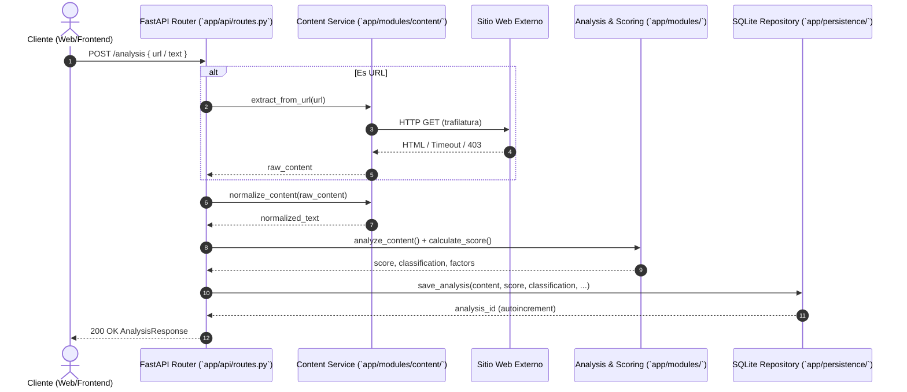
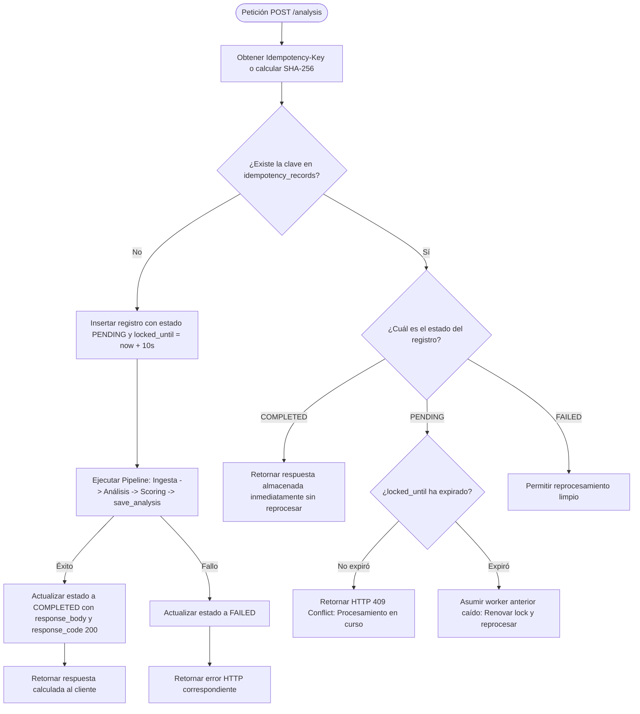
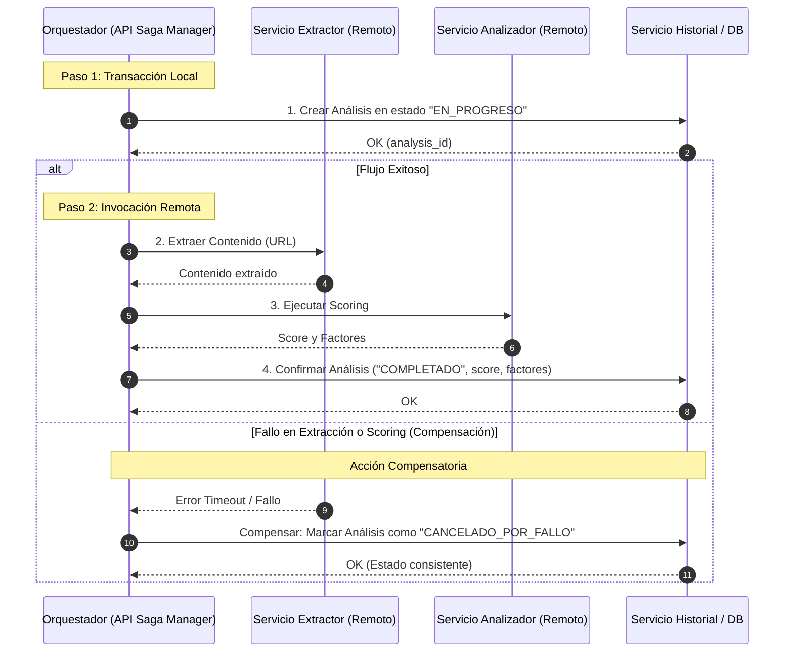

# Análisis de Resiliencia, Modos de Fallo, Idempotencia y Decisión de Extracción

**Proyecto:** VeriFacts — Sistema de Detección de Desinformación  
**Equipo:** Pedro Jose Castro Blanquicett, Cristian David Cardeno  
**Repositorio:** [https://github.com/ISCOUTB/AS_202620_Verifacts](https://github.com/ISCOUTB/AS_202620_Verifacts)  
**Commit de referencia:** [`65a44af2e0e9fd17f0672f64c6ded3c26f588121`](https://github.com/ISCOUTB/AS_202620_Verifacts/commit/65a44af2e0e9fd17f0672f64c6ded3c26f588121)  

---

## 1. Selección de la Pieza Concreta del Sistema

Para este análisis de resiliencia y diseño arquitectónico se selecciona una pieza crítica delimitada del sistema:

> **Pieza seleccionada:** El **Pipeline de Ingesta Externa y Creación de Análisis** (`POST /analysis`), coordinado por `app/api/routes.py`, `app/modules/content/service.py`, `app/modules/analysis/service.py`, `app/modules/scoring/service.py` y `app/persistence/repository.py`.

### Justificación de la elección:
1. **Punto neurálgico de interacción:** Es el único flujo transaccional de escritura y cómputo central del negocio. Cruza los tres contextos delimitados identificados en [`docs/mapa-contextos.md`](../mapa-contextos.md): *Ingesta y Presentación*, *Análisis de Contenido* e *Historial de Análisis*.
2. **Frontera de red no confiable:** Integra comunicación con el mundo exterior mediante web scraping síncrono (`trafilatura.fetch_url`), exponiendo al sistema a latencias variables, caídas de sitios de terceros y anomalías de red.
3. **Cómputo determinista vs. Mutación persistente:** Ejecuta reglas lingüísticas en memoria y finaliza con una mutación en base de datos (`save_analysis`), lo que la convierte en el punto primario donde pueden ocurrir estados inconsistentes o duplicación de datos ante reintentos de clientes.



---

## 2. Tabla de Modos de Fallo y Mitigación

La siguiente matriz documenta los modos de fallo identificados en cada eslabón del pipeline seleccionado, su severidad, la táctica arquitectónica aplicada y su mecanismo de verificación/telemetría.

| ID | Componente / Eslabón | Modo de Fallo | Causa Raíz | Impacto en el Sistema | Táctica Arquitectónica y Mitigación | Detección y Telemetría |
|---|---|---|---|---|---|---|
| **MF-01** | Ingesta Externa (`Content`) | **Timeout de red externa / Caída de sitio origen** | Servidor de la URL solicitada inaccesible, con alta latencia (> 15 s) o sin respuesta. | Hilo del worker bloqueado esperando I/O; violación de Q-01 (P95 ≤ 3.000 ms); degradación del servicio para otros usuarios. | **Timeout estricto y degradación controlada:** Configurar timeout de conexión y lectura máximo de 4.000 ms en `trafilatura`. Capturar la excepción y responder con `HTTP 504 Gateway Timeout` semántico en lugar de fallar con error 500 no controlado. | Log estructurado con etiqueta `error="url_timeout"`; métrica en `observability.py` de latencias de scraping. |
| **MF-02** | Ingesta Externa (`Content`) | **Bloqueo de scraping / Error HTTP remoto (403/404/500)** | El sitio destino aplica protecciones anti-bot (Cloudflare, CAPTCHA) o la página no existe. | La extracción falla sin contenido textual; el usuario no recibe análisis. | **Aislamiento de fallo y validación semántica:** Detección de código HTTP remoto; mapeo a `HTTP 422 Unprocessable Content` con mensaje claro al usuario: *"No se pudo extraer contenido legible de la URL provista"*. | Contador de errores por código de estado de origen en telemetría. |
| **MF-03** | Ingesta y Normalización (`Content`) | **Agotamiento de memoria / CPU DoS por Payload Gigante** | Entrada maliciosa o sitio web con documento inmenso (> 10 MB) que satura expresiones regulares. | Saturación del contenedor de 512 MB de RAM; riesgo de reinicio abrupto por OOM (*Out Of Memory*). | **Validación temprana y limitación de límites (Bounds enforcement):** Validar longitud máxima antes de normalizar (`MAX_CONTENT_LENGTH = 100.000` caracteres). Truncar de forma segura o rechazar con `HTTP 413 Payload Too Large`. | Conteo de peticiones truncadas o rechazadas en `observability.py`. |
| **MF-04** | Persistencia (`Persistence`) | **Bloqueo concurrente de SQLite (`database is locked`)** | Múltiples escrituras simultáneas en `save_analysis()` superan la ventana de concurrencia de SQLite. | La petición falla con `sqlite3.OperationalError`; el usuario recibe error 500 a pesar de que el análisis ya fue calculado en CPU. | **Modo WAL y reintento con backoff:** Activar `journal_mode=WAL` (Write-Ahead Logging) en SQLite para permitir lecturas concurrentes sin bloquear escrituras; configurar `busy_timeout=5000` ms y envoltorio con reintento automático (3 intentos con jitter). | Alerta de excepciones `OperationalError` en logs del repositorio. |
| **MF-05** | Frontera Cliente ↔ API (`API`) | **Pérdida de confirmación de red (Network Partition)** | La base de datos guarda exitosamente el registro, pero la conexión HTTP se corta antes de entregar el 200 OK al cliente. | El cliente reintenta enviar la misma petición; se crean registros duplicados en la base de datos y se repite el cómputo. | **Diseño de Idempotencia:** Implementación de cabecera `Idempotency-Key` (o hash SHA-256 del contenido como fallback) con tabla de deduplicación transaccional. | Métrica de `idempotency_cache_hit` y reintentos detectados. |
| **MF-06** | Análisis Lingüístico (`Analysis`) | **Regresión semántica en reglas** | Modificación involuntaria de un umbral o peso de regla que altera las clasificaciones históricas. | Pérdida de repetibilidad (violación de Q-05); clasificaciones erróneas o inconsistentes. | **Pruebas de erosión de límites (Boundary tests):** Suite automatizada `test_boundaries.py` y `test_scoring_boundaries.py` como compuerta de calidad bloqueante en CI/CD. | Ejecución automática en GitHub Actions en cada commit. |

---

## 3. Diseño de Idempotencia o Saga

### 3.1. Evaluación: ¿Idempotencia o Saga?

- **¿Aplica Saga distribuida en el estado actual?**
  **NO.** En la arquitectura actual de monolito modular, no existen múltiples bases de datos ni servicios distribuidos autónomos. Todas las operaciones de extracción y scoring son puramente computacionales en memoria, y la única mutación de estado persistente ocurre en SQLite dentro de una sola transacción local ACID. Una Saga en este punto introduciría sobreingeniería injustificada.
  *(Nota: Se incluye en la sección 3.3 el diseño conceptual de la Saga que aplicaría si el módulo de extracción fuese extraído en el futuro).*

- **¿Aplica Idempotencia en la API?**
  **SÍ, de forma directa y prioritaria.** La operación `POST /analysis` es una operación de creación de recurso. Actualmente, si el frontend o un script sufre un microcorte de red tras la ejecución de `save_analysis()`, el cliente reintenta y la API ejecuta todo el análisis de nuevo y genera un **nuevo registro con ID diferente**, duplicando el historial y desperdiciando ciclos de CPU.

---

### 3.2. Diseño Detallado del Mecanismo de Idempotencia

El objetivo es garantizar que **múltiples invocaciones idénticas de `POST /analysis` produzcan exactamente el mismo resultado y no generen efectos secundarios adicionales (duplicidad de registros)**.

#### A. Estrategia de Clave de Idempotencia
1. **Cabecera primaria (`Idempotency-Key`):** El cliente genera un UUID v4 antes de enviar la solicitud y lo incluye en la cabecera HTTP `Idempotency-Key: <UUID>`.
2. **Fallback determinista (Content Fingerprint):** Si el cliente no provee la cabecera, el backend calcula automáticamente un hash SHA-256 sobre la entrada normalizada:
   $$\text{Fingerprint} = \text{SHA-256}(\text{source\_type} + \text{"::"} + \text{content})$$

#### B. Modelo de Datos y Máquina de Estados de Idempotencia
Se añade una tabla transaccional `idempotency_records` en el repositorio:

```sql
CREATE TABLE IF NOT EXISTS idempotency_records (
    key TEXT PRIMARY KEY,
    status TEXT NOT NULL CHECK(status IN ('PENDING', 'COMPLETED', 'FAILED')),
    request_hash TEXT NOT NULL,
    response_code INTEGER,
    response_body TEXT,
    created_at TIMESTAMP DEFAULT CURRENT_TIMESTAMP,
    locked_until TIMESTAMP NOT NULL
);
```

#### C. Flujo de Ejecución y Manejo de Concurrencia



#### D. Beneficios del Diseño
1. **Prevención de duplicados:** La misma petición reenviada retorna el mismo `id` y `created_at` del análisis previo.
2. **Ahorro computacional:** No se vuelve a ejecutar `trafilatura` ni las reglas de análisis para peticiones idénticas.
3. **Manejo de concurrencia segura:** El estado `PENDING` con bloqueo temporal (`locked_until`) previene condiciones de carrera (*race conditions*) si dos hilos intentan procesar la misma clave simultáneamente.

---

### 3.3. Diseño de Saga Compensatoria (En caso de extracción futura)

Si en el futuro se aplicase la extracción del módulo de extracción/análisis a un servicio independiente (`Analysis Worker Service`) separado del servicio de API y Persistencia (`Core API`), el pipeline se transformaría en una transacción distribuida que requeriría una **Saga Orquestada**:



- **Acción hacia adelante (Forward Action):** Reservar registro de análisis $\rightarrow$ Extraer texto $\rightarrow$ Calcular indicadores $\rightarrow$ Publicar y confirmar.
- **Acción compensatoria (Compensating Transaction):** Si la extracción remota o el cálculo de scoring fallan tras haber reservado el ID, la transacción compensatoria marca el registro como `FALLIDO` o elimina el registro huérfano, garantizando que el historial nunca exhiba estados corruptos.

---

## 4. ADR Asociado

La decisión formal sobre la extracción del módulo se encuentra documentada en el registro de decisiones arquitectónicas del repositorio:

> 👉 **Documento formal:** [`docs/adr/0009-decision-extraccion-modulo-analisis.md`](../adr/0009-decision-extraccion-modulo-analisis.md)
> - **Título:** ADR-0009: Decisión de no extraer el módulo de Extracción y Análisis de Contenido
> - **Estado:** Aceptado
> - **Decisión clave:** Mantener la arquitectura de monolito modular sin separar microservicios, respaldada por la satisfacción de Q-01 (P95 ≤ 3.000 ms), reducción de fallos parciales de red y cumplimiento de las restricciones de costo y equipo (R-ORG-01, R-ORG-02, R-TEC-05).

---

## 5. Enlaces y Trazabilidad

- **Repositorio:** [https://github.com/ISCOUTB/AS_202620_Verifacts](https://github.com/ISCOUTB/AS_202620_Verifacts)
- **Commit evaluado:** [`65a44af2e0e9fd17f0672f64c6ded3c26f588121`](https://github.com/ISCOUTB/AS_202620_Verifacts/commit/65a44af2e0e9fd17f0672f64c6ded3c26f588121)
- **ADR Relacionados:**
  - [ADR-0001: Usar monolito modular](../adr/0001-estilo-arquitectonico.md)
  - [ADR-0003: Mantener integración síncrona](../adr/0003-integracion-sincrona.md)
  - [ADR-0008: Mantener Render y mitigar arranque en frío](../adr/0008-mantener-render-mitigar-arranque-frio.md)
  - [ADR-0009: Decisión de no extraer el módulo de análisis](../adr/0009-decision-extraccion-modulo-analisis.md)
